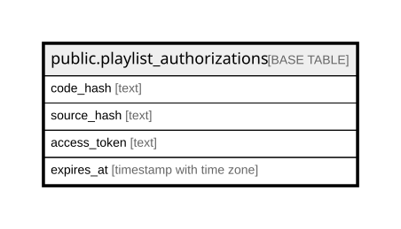

# public.playlist_authorizations

## Columns

| Name | Type | Default | Nullable | Children | Parents | Comment |
| ---- | ---- | ------- | -------- | -------- | ------- | ------- |
| code_hash | text |  | false |  |  |  |
| source_hash | text |  | false |  |  |  |
| access_token | text |  | false |  |  |  |
| expires_at | timestamp with time zone |  | false |  |  |  |

## Constraints

| Name | Type | Definition |
| ---- | ---- | ---------- |
| playlist_authorizations_access_token_not_null | n | NOT NULL access_token |
| playlist_authorizations_code_hash_not_null | n | NOT NULL code_hash |
| playlist_authorizations_expires_at_not_null | n | NOT NULL expires_at |
| playlist_authorizations_source_hash_not_null | n | NOT NULL source_hash |
| playlist_authorizations_pkey | PRIMARY KEY | PRIMARY KEY (code_hash) |

## Indexes

| Name | Definition |
| ---- | ---------- |
| playlist_authorizations_pkey | CREATE UNIQUE INDEX playlist_authorizations_pkey ON public.playlist_authorizations USING btree (code_hash) |
| playlist_authorizations_expiry_idx | CREATE INDEX playlist_authorizations_expiry_idx ON public.playlist_authorizations USING btree (expires_at) |

## Relations

---

> Generated by [tbls](https://github.com/k1LoW/tbls)
