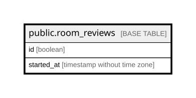

# public.room_reviews

## Columns

| Name | Type | Default | Nullable | Children | Parents | Comment |
| ---- | ---- | ------- | -------- | -------- | ------- | ------- |
| id | boolean | true | false |  |  |  |
| started_at | timestamp without time zone |  | true |  |  |  |

## Constraints

| Name | Type | Definition |
| ---- | ---- | ---------- |
| room_reviews_id_check | CHECK | CHECK (id) |
| room_reviews_id_not_null | n | NOT NULL id |
| room_reviews_pkey | PRIMARY KEY | PRIMARY KEY (id) |

## Indexes

| Name | Definition |
| ---- | ---------- |
| room_reviews_pkey | CREATE UNIQUE INDEX room_reviews_pkey ON public.room_reviews USING btree (id) |

## Relations

---

> Generated by [tbls](https://github.com/k1LoW/tbls)
