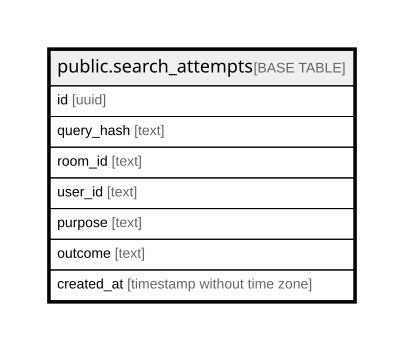

# public.search_attempts

## Columns

| Name | Type | Default | Nullable | Children | Parents | Comment |
| ---- | ---- | ------- | -------- | -------- | ------- | ------- |
| id | uuid |  | false |  |  |  |
| query_hash | text |  | false |  |  |  |
| room_id | text |  | false |  |  |  |
| user_id | text |  | false |  |  |  |
| purpose | text |  | false |  |  |  |
| outcome | text | 'reserved'::text | false |  |  |  |
| created_at | timestamp without time zone | now() | false |  |  |  |

## Constraints

| Name | Type | Definition |
| ---- | ---- | ---------- |
| search_attempts_created_at_not_null | n | NOT NULL created_at |
| search_attempts_id_not_null | n | NOT NULL id |
| search_attempts_outcome_not_null | n | NOT NULL outcome |
| search_attempts_purpose_not_null | n | NOT NULL purpose |
| search_attempts_query_hash_not_null | n | NOT NULL query_hash |
| search_attempts_room_id_not_null | n | NOT NULL room_id |
| search_attempts_user_id_not_null | n | NOT NULL user_id |
| search_attempts_pkey | PRIMARY KEY | PRIMARY KEY (id) |

## Indexes

| Name | Definition |
| ---- | ---------- |
| search_attempts_pkey | CREATE UNIQUE INDEX search_attempts_pkey ON public.search_attempts USING btree (id) |
| search_attempts_created_at_idx | CREATE INDEX search_attempts_created_at_idx ON public.search_attempts USING btree (created_at) |
| search_attempts_user_created_at_idx | CREATE INDEX search_attempts_user_created_at_idx ON public.search_attempts USING btree (user_id, created_at) |
| search_attempts_room_created_at_idx | CREATE INDEX search_attempts_room_created_at_idx ON public.search_attempts USING btree (room_id, created_at) |

## Relations

---

> Generated by [tbls](https://github.com/k1LoW/tbls)
