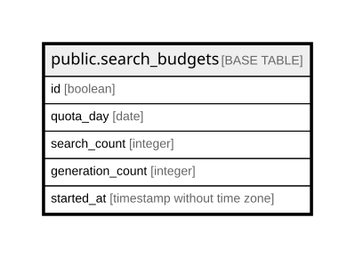

# public.search_budgets

## Columns

| Name | Type | Default | Nullable | Children | Parents | Comment |
| ---- | ---- | ------- | -------- | -------- | ------- | ------- |
| id | boolean | true | false |  |  |  |
| quota_day | date | CURRENT_DATE | false |  |  |  |
| search_count | integer | 0 | false |  |  |  |
| generation_count | integer | 0 | false |  |  |  |
| started_at | timestamp without time zone |  | true |  |  |  |

## Constraints

| Name | Type | Definition |
| ---- | ---- | ---------- |
| search_budgets_generation_count_not_null | n | NOT NULL generation_count |
| search_budgets_id_check | CHECK | CHECK (id) |
| search_budgets_id_not_null | n | NOT NULL id |
| search_budgets_quota_day_not_null | n | NOT NULL quota_day |
| search_budgets_search_count_not_null | n | NOT NULL search_count |
| search_budgets_pkey | PRIMARY KEY | PRIMARY KEY (id) |

## Indexes

| Name | Definition |
| ---- | ---------- |
| search_budgets_pkey | CREATE UNIQUE INDEX search_budgets_pkey ON public.search_budgets USING btree (id) |

## Relations

---

> Generated by [tbls](https://github.com/k1LoW/tbls)
