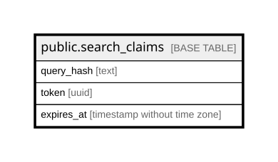

# public.search_claims

## Columns

| Name | Type | Default | Nullable | Children | Parents | Comment |
| ---- | ---- | ------- | -------- | -------- | ------- | ------- |
| query_hash | text |  | false |  |  |  |
| token | uuid |  | false |  |  |  |
| expires_at | timestamp without time zone |  | false |  |  |  |

## Constraints

| Name | Type | Definition |
| ---- | ---- | ---------- |
| search_claims_expires_at_not_null | n | NOT NULL expires_at |
| search_claims_query_hash_not_null | n | NOT NULL query_hash |
| search_claims_token_not_null | n | NOT NULL token |
| search_claims_pkey | PRIMARY KEY | PRIMARY KEY (query_hash) |

## Indexes

| Name | Definition |
| ---- | ---------- |
| search_claims_pkey | CREATE UNIQUE INDEX search_claims_pkey ON public.search_claims USING btree (query_hash) |
| search_claims_expires_at_idx | CREATE INDEX search_claims_expires_at_idx ON public.search_claims USING btree (expires_at) |

## Relations

---

> Generated by [tbls](https://github.com/k1LoW/tbls)
